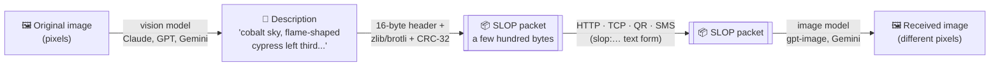

<h1 align="center">SLOP</h1>

<p align="center"><strong>The Semantically Lossy Object Protocol</strong></p>

<p align="center"><em>Lossy compression, but the loss is the content.</em><br>
It's a picture of a thing. Probably.</p>

<p align="center">
  <a href="https://github.com/ericlove02/slop-protocol/actions/workflows/ci.yml"></a>
  
  
  
  
  
  
</p>

<!-- slop:hero -->
_No benchmark results committed yet. Run `slop bench` with your keys set (see [Benchmarks](#running-the-benchmarks)); this section is generated from `benchmarks/results/results.json`._
<!-- /slop:hero -->

---

## Why SLOP?

Pixels are a legacy technology. They were designed in an era when the only
way to show someone a picture was to show them the picture. We have moved on.

Consider the economics. Bandwidth is expensive: every byte you send crosses
cables, routers, and occasionally the ocean. GPUs, on the other hand, are free.<sup>[1]</sup>
So instead of sending the picture, SLOP sends what the picture *means*, and lets
the other side's GPU figure out the details. The details will be different.
That's the "lossy" part. We are upfront about this. It's in the name.

**SLOP is ideal for:**

- Sharing photos where the exact photo doesn't matter
- Sending your friend "basically the same" sunset
- Transferring images over SMS, QR codes, and the small amount of space left in a tweet
- Proving that an enormous size reduction and a mediocre likeness can coexist in one product

**SLOP is not for:**

- Anything you need back
- Evidence
- Medical imaging (**no**)

<sub>[1] They are not.</sub>

## How it works



1. **Transmit.** A vision model (Claude by default) looks at the image and writes
   an obsessively dense description: a composition grid, every object with
   colour names and hex codes, positions, textures, lighting, camera angle,
   mood, and any text verbatim. No filler. Every byte is paid for twice.
2. **Pack.** The description goes into a SLOP packet: `SLOP` magic, version,
   flags, a width/height hint, the (optionally zlib- or Brotli-compressed) body,
   and a CRC-32. It is a real, tiny, binary format, specified in mock-RFC detail
   in [`SPEC.md`](SPEC.md). There is also a `slop:` text form you can paste into
   a chat.
3. **Receive.** The receiver validates the packet and hands the description to an
   image-generation model, which produces an image. Not the image. An image.

Claude can look at pictures but can't make them, so the receiving end always
uses a real image model (OpenAI or Google Gemini; Stability, Replicate and local
`diffusers` are optional). You'll need a key for one of those, too.

## Quickstart

```bash
git clone https://github.com/ericlove02/slop-protocol.git
cd slop-protocol
pip install -e ".[all]"
```

Set an encoder key and a decoder key (or put them in a `.env` file; see
[`.env.example`](.env.example)):

```bash
export ANTHROPIC_API_KEY=sk-ant-...
export OPENAI_API_KEY=sk-...        # or: export GEMINI_API_KEY=...
```

Check what SLOP can see (it prints key *names*, never values):

```bash
slop doctor
```

Encode an image into a packet, look inside, and decode it back into an image:

```bash
slop encode examples/originals/04_painting.jpg -o painting.slop
```

```bash
slop inspect painting.slop
```

```bash
slop decode painting.slop -o received.png
```

Squeeze it into a tweet, in telegraphic English:

```bash
slop encode examples/originals/04_painting.jpg -o tweet.slop --max-bytes tweet --terse --text
```

Send it over the network. In one terminal:

```bash
slop serve --port 8080 --out inbox/
```

In another:

```bash
slop send examples/originals/04_painting.jpg --to http://127.0.0.1:8080
```

The receiver writes the packet, its description and the generated image into
`inbox/` and replies with a JSON receipt.

### More ways to move a picture without moving the picture

| Command | What it does |
| --- | --- |
| `slop listen --tcp 5150` / `slop send photo.jpg --tcp host:5150` | Raw TCP, one packet per connection, `ACK`/`NAK` reply. For maximum retro. |
| `slop qr photo.jpg -o photo_qr.png` | Encode the image as a QR code of its own description. |
| `slop unqr photo_qr.png -o out.png` | Scan that QR code and decode it back into an image. |
| `slop telephone photo.jpg --rounds 10` | Encode → decode → encode the output → ... and keep every generation. |
| `slop bench examples/originals/` | Run the benchmark (asks before spending money). |
| `slop report` | Regenerate tables, grids and this README's results from the committed JSON. Free. |

Useful flags: `--vision anthropic|openai|gemini|openai_compat`,
`--backend auto|openai|gemini|stability|replicate|local`, `--model`,
`--max-bytes N|tweet|sms|kilobyte`, `--max-chars N` (budget for the text form),
`--terse`, `--seed` (where the backend supports it), `--compression auto|none|zlib|brotli`.

### Python API

```python
import slop

packet = slop.encode("examples/originals/01_geometric.png", max_bytes=280)
print(len(packet.to_bytes()), packet.description)
print(packet.to_text())  # slop:… for pasting into a chat

image = slop.decode(packet, backend="gemini")  # a PIL.Image
image.save("received.png")
```

`slop.encode_detailed()` and `slop.decode_detailed()` also return token usage,
latency and estimated cost.

### Local and alternative providers

- **Any OpenAI-compatible endpoint as the encoder** (Ollama, LM Studio, OpenRouter):
  set `SLOP_OPENAI_COMPAT_BASE_URL` (e.g. `http://localhost:11434/v1`) and
  `SLOP_OPENAI_COMPAT_MODEL` (a vision model such as `llava`), then use `--vision openai_compat`.
- **Local decoder:** `pip install -e ".[local]"` and `--backend local` runs SDXL-Turbo via
  `diffusers`. No key, no bill, just your GPU.
- **Stability AI / Replicate:** `pip install -e ".[stability]"` or `".[replicate]"`, set
  `STABILITY_API_KEY` or `REPLICATE_API_TOKEN`.

Model names are defaults, not destiny: every one lives in
[`src/slop/config.py`](src/slop/config.py) and can be overridden with an env var
(`SLOP_ANTHROPIC_VISION_MODEL`, `SLOP_OPENAI_IMAGE_MODEL`, `SLOP_GEMINI_IMAGE_MODEL`, ...)
or `--model`.

## Results

Eight test images, chosen to range from "SLOP's best case" to "SLOP's nemesis":
flat geometry, a landscape, a still life, a public-domain painting, a busy
market, a sign with text, a bar chart, and pure noise. Sources and licenses are
in [`examples/SOURCES.md`](examples/SOURCES.md). Every number below is generated
from [`benchmarks/results/results.json`](benchmarks/results/results.json) by
`slop report`.

<!-- slop:results -->
_No benchmark results committed yet. Run `slop bench` with your keys set (see [Benchmarks](#running-the-benchmarks)); this section is generated from `benchmarks/results/results.json`._
<!-- /slop:results -->

### Normal vs. terse English

`--terse` asks for telegraphic English: no articles, abbreviations, hex codes
instead of adjectives. Does dropping "the" buy anything?

<!-- slop:languages -->
_No benchmark results committed yet. Run `slop bench` with your keys set (see [Benchmarks](#running-the-benchmarks)); this section is generated from `benchmarks/results/results.json`._
<!-- /slop:languages -->

### OpenAI vs. Gemini

Same packets, different imaginations.

<!-- slop:backends -->
_No benchmark results committed yet. Run `slop bench` with your keys set (see [Benchmarks](#running-the-benchmarks)); this section is generated from `benchmarks/results/results.json`._
<!-- /slop:backends -->

## Budget sweep

The same image at full detail, 1 KB, 280 bytes ("fits in a tweet") and 160 bytes
("fits in an SMS"). Watch the picture leave.

<!-- slop:sweep -->
_No benchmark results committed yet. Run `slop bench` with your keys set (see [Benchmarks](#running-the-benchmarks)); this section is generated from `benchmarks/results/results.json`._
<!-- /slop:sweep -->

## The telephone game

`slop telephone` encodes an image, decodes it, then encodes *the output*, and so
on. Every generation is a faithful description of the previous generation.
Nothing is ever faithful to the original.

<!-- slop:telephone -->
_No benchmark results committed yet. Run `slop bench` with your keys set (see [Benchmarks](#running-the-benchmarks)); this section is generated from `benchmarks/results/results.json`._
<!-- /slop:telephone -->

## Cost analysis

<!-- slop:cost -->
_No benchmark results committed yet. Run `slop bench` with your keys set (see [Benchmarks](#running-the-benchmarks)); this section is generated from `benchmarks/results/results.json`._
<!-- /slop:cost -->

## FAQ

**Is this lossless?**
No. It is the opposite of lossless. The loss is the point. The only thing SLOP
transmits exactly is the image's width and height, and the receiver's model may
ignore those too.

**Can I use it for medical imaging?**
**No.** Absolutely not. Not for X-rays, not for scans, not for "just a quick
look." The received image is a confident invention.

**Is it secure?**
The packet has a CRC-32, which protects your description from cosmic rays and
nothing else. The description is plain English and tells anyone who reads it
exactly what your picture contains, which is arguably *worse* than sending the
JPEG. See [SPEC.md § 10](SPEC.md#10-security-considerations), which also covers
finger counts, prompt injection, and denial-of-wallet.

**Will I get the same image if I decode twice?**
No. Every viewing is a unique experience. `--seed` helps on backends that
support it (Gemini, Stability, Replicate, local). OpenAI's image models do not
take a seed, and SLOP will tell you so.

**Does it work on photos of people?**
Please don't. The received person will be a stranger, and neither of them
consented. The example set deliberately contains no identifiable people.

**Can Claude do the decoding too?**
No. Claude can read images but cannot generate them, and SLOP refuses to fake it
with SVG or ASCII art. The receiver uses a real image model.

**Why?**
Because somebody had to measure it. The engineering is real, the tests pass,
the numbers come from real runs, and the protocol has a spec with MUST and
SHOULD in it. That this is all in service of sending a worse picture more
slowly at greater cost is, we feel, a reflection of the times.

## Known limitations (features)

- **Non-deterministic.** Every viewing is a unique experience.
- **Unbounded creativity.** The receiver may add a cat. You did not send a cat. You have a cat now.
- **Typographic interpretation.** Text in images arrives in the spirit of the original text.
- **Statistical honesty.** Charts preserve the general idea that some bars were taller than others.
- **Noise intolerance.** Random noise is described as "random noise", and received as a different, equally valid random noise. Technically this is perfect.
- **Latency.** SLOP waits for two large models in a row. See the latency columns above. You are paying for the thinking.
- **Cost.** SLOP is the only image format with a per-image invoice.
- **Exact dimensions.** Image models offer a few aspect ratios; your 1023×511 image will be received as something wide.

## Roadmap

- **SLOP-V (video):** transmit the plot summary. Receiver generates a film. Runtime may vary.
- **SLOP-A (audio):** hum it.
- **SLOP-T (text):** send a summary of the text; receive a longer, different text. (This already exists. It's called email.)
- **SLOP-FS:** a filesystem where every file is stored as a description of itself. `cat` becomes creative writing.
- **SLOP over SLOP:** encode a screenshot of a SLOP packet as a SLOP packet. Research suggests the result is a picture of a QR code.
- **Lossless mode:** under consideration since the beginning. Blocked on physics.

## Contributing

Contributions are welcome, especially ones that make SLOP more correct at
being less correct.

```bash
pip install -e ".[dev]"
```

```bash
ruff check . && ruff format --check .
```

```bash
pytest
```

The test suite uses fake providers and never touches a paid API. Tests that do
are marked `live` and skipped by default; run them with real keys via
`pytest -m live` (a few cents).

Project layout: the wire format is in `src/slop/packet.py`, prompts in
`src/slop/prompts.py`, provider adapters in `src/slop/providers/`, transports in
`src/slop/transport/`, and the benchmark in `src/slop/bench/`. Model names and
prices live only in `src/slop/config.py`.

### Running the benchmarks

```bash
slop bench examples/originals --dry-run
```

prints the plan, the number of API calls, and an estimated cost, then stops.
Without `--dry-run` it asks for confirmation before spending anything. The full
README run, including the budget sweep and two telephone games:

```bash
slop bench examples/originals --backends openai,gemini --sweep 04_painting --telephone 04_painting,03_still_life
```

Results go to `benchmarks/results/results.json` after every step, so an
interrupted run resumes instead of paying twice. Outputs go to
`examples/outputs/`. `slop report` rebuilds every table, grid, and README
section from that JSON. Backends without a key are skipped and recorded as
skipped. Prices are estimates from `config.py`; edit them, or set
`SLOP_PRICES_JSON`.

`examples/originals/` can be regenerated with `python scripts/make_examples.py`.

## License

[MIT](LICENSE). SLOP was invented by Eric Love, and is, literally, made with Love.
